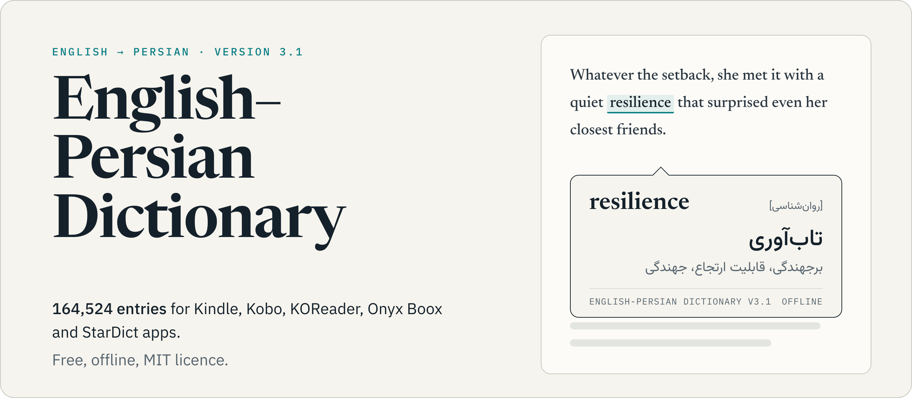
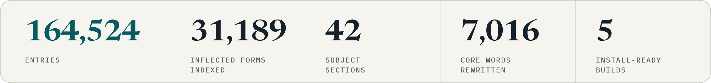
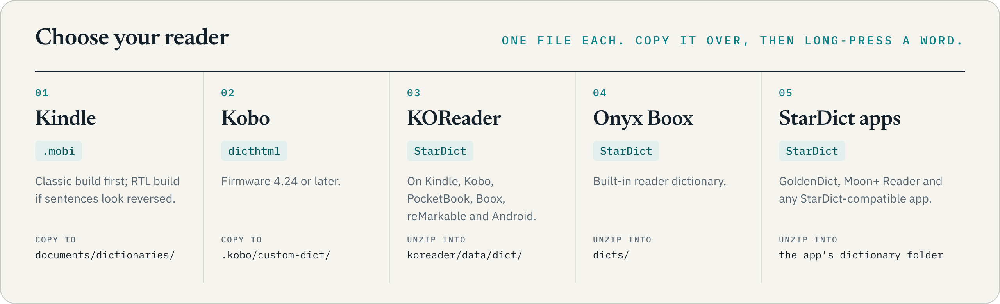
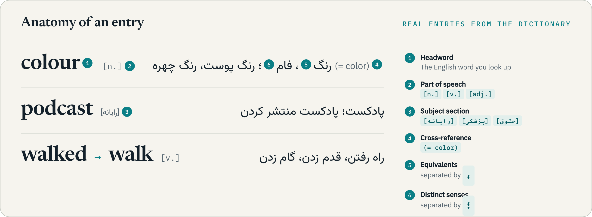
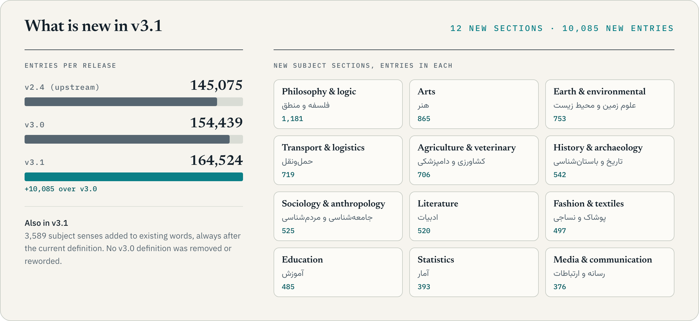
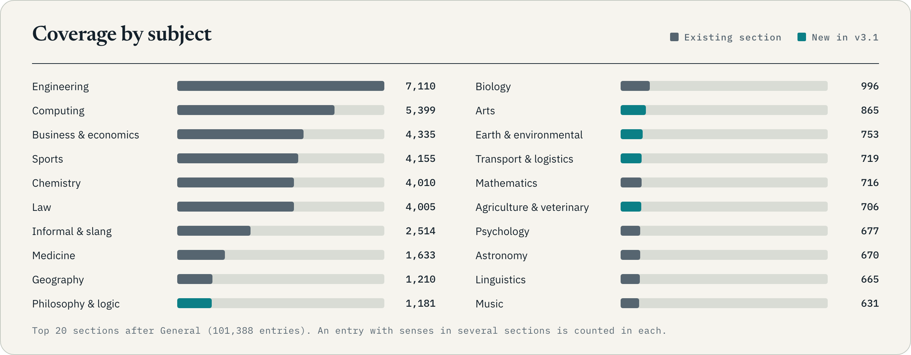

<p align="center">
  <a href="https://shahabahreini.github.io/English-Persian-Dictionary/"></a>
</p>

<p align="center">
  <a href="https://github.com/shahabahreini/English-Persian-Dictionary/releases/latest"></a>
  
  
  <a href="LICENSE"></a>
</p>

<p align="center">
  <a href="https://shahabahreini.github.io/English-Persian-Dictionary/"><b>Website</b></a> &nbsp;·&nbsp;
  <a href="https://github.com/shahabahreini/English-Persian-Dictionary/releases/tag/v3.1.0"><b>Download</b></a> &nbsp;·&nbsp;
  <a href="#download">Install guide</a> &nbsp;·&nbsp;
  <a href="https://shahabahreini.github.io/English-Persian-Dictionary/report.html">Change report</a> &nbsp;·&nbsp;
  <a href="#frequently-asked-questions">FAQ</a> &nbsp;·&nbsp;
  <a href="#فارسی">فارسی</a>
</p>

<p align="center"></p>

# English–Persian Dictionary for Kindle, Kobo & KOReader

A free, offline **English-to-Persian (Farsi) dictionary** with **164,524 entries** and 31,189 indexed inflected forms, packaged for e-readers: **Kindle** (`.mobi`), **Kobo**, **KOReader**, **Onyx Boox**, GoldenDict and other **StarDict** apps. Long-press a word in a book and read the Persian meaning, with no internet connection.

### Start here: [**open the website, pick your device and download**](https://shahabahreini.github.io/English-Persian-Dictionary/)

The [project website](https://shahabahreini.github.io/English-Persian-Dictionary/) is the easiest place to start: choose your e-reader (Kindle, Kobo, KOReader, Onyx Boox) and it shows the right file with step-by-step install instructions. A Persian version is at [شروع از صفحهٔ فارسی](https://shahabahreini.github.io/English-Persian-Dictionary/fa/).

| Where to click | What you get |
|---|---|
| [**Website**](https://shahabahreini.github.io/English-Persian-Dictionary/) | Device picker, install guides, FAQ |
| [**Release v3.1.0**](https://github.com/shahabahreini/English-Persian-Dictionary/releases/tag/v3.1.0) | Direct downloads of every file |
| [Change report](https://shahabahreini.github.io/English-Persian-Dictionary/report.html) | Every new and corrected entry, searchable |
| [صفحهٔ فارسی](https://shahabahreini.github.io/English-Persian-Dictionary/fa/) | Persian site with installation guide |

[Download table](#download) · [FAQ](#frequently-asked-questions) · [فارسی ↓](#فارسی)

> **Read this first:** the new and rewritten Persian wording was produced by AI language models and has **not been reviewed by a human Persian editor**. See [Known limits](#known-limits). Corrections are very welcome.

## At a glance

| | |
|---|---|
| **Direction** | English → Persian |
| **Devices** | Kindle, Kobo, KOReader (Kindle, Kobo, PocketBook, Boox, reMarkable, Android), Onyx Boox, GoldenDict, Moon+ Reader, any StarDict app |
| **Coverage** | General vocabulary plus over 40 subject sections, from computing and medicine to philosophy and fashion. Looking up *walked* opens *walk* |
| **Licence** | MIT, free to use and redistribute |
| **Based on** | *English-Persian Dictionary v2.4* by H. Yazdani, via [hossein1376/English-Persian-Kindle-Custom-Dictionary](https://github.com/hossein1376/English-Persian-Kindle-Custom-Dictionary). See [CREDITS.md](CREDITS.md) |

## Download

<p align="center"></p>

Pick your device, download the file (also attached to the [v3.1.0 release](https://github.com/shahabahreini/English-Persian-Dictionary/releases/tag/v3.1.0)) and follow the install step.

| Your device | File | Install |
|---|---|---|
| **Kindle** (E Ink) | [`English-Persian.Dictionary.v3.1-classic.mobi`](dist/kindle/English-Persian.Dictionary.v3.1-classic.mobi) | Copy to `documents/dictionaries/` on the Kindle. In a book, long-press a word, tap the dictionary name and choose *English-Persian Dictionary v3.1*. Or set it under *Settings › Language & Dictionaries › Dictionaries › English*. |
| **Kindle**, if the classic build shows sentences reversed | [`English-Persian.Dictionary.v3.1-rtl.mobi`](dist/kindle/English-Persian.Dictionary.v3.1-rtl.mobi) | Same as above. For apps and firmware that handle right-to-left text. |
| **Kobo** (firmware 4.24+) | [`dicthtml-en-fa.zip`](dist/kobo/dicthtml-en-fa.zip) | Copy to `.kobo/custom-dict/` (create it if needed), eject, then pick it under *Settings › Language and dictionaries*. |
| **KOReader**, **Onyx Boox**, GoldenDict, Moon+ Reader, other StarDict apps | [`English-Persian-v3.1-stardict.zip`](dist/stardict/English-Persian-v3.1-stardict.zip) | Unzip into `koreader/data/dict/` (KOReader) or the app's dictionary folder (Boox: `dicts/`). |
| Readers that print HTML tags as text (CoolReader, early PocketBook / Onyx firmware) | [`English-Persian-v3.1-stardict-plaintext.zip`](dist/stardict/English-Persian-v3.1-stardict-plaintext.zip) | Same as above. |
| Your own tools | [`English-Persian.v3.1.tsv`](data/English-Persian.v3.1.tsv) | Tab-separated: headword, definition, sections, status, alternate forms. |

**Which Kindle file?** Kindle pop-ups on E Ink lay text out left to right and do not reorder right-to-left scripts. Following v2.4, the **classic** build stores each definition with its words in reverse order so it *displays* correctly. The **RTL** build keeps natural order in right-to-left paragraphs. Try classic first; switch to RTL if sentences look reversed. The StarDict, Kobo and TSV files use normal reading order.

> **Upgrading?** If v2.4 or v3.0 is still on the Kindle, delete it once you are happy with v3.1, or leave both and choose in the pop-up.

## How to read an entry

<p align="center"></p>

- `[n.]`, `[v.]`, `[adj.]` … part of speech. `[رایانه]`, `[پزشکی]`, `[حقوق]` … subject section.
- `▪` separates sense groups (plain-text builds use `|`), `،` separates equivalents, `؛` separates distinct senses.
- `(= colour)` is a cross-reference; `(گذشتهٔ go)`, `(جمعِ child)` mark irregular forms.

## What's new in v3.1

<p align="center"></p>

Twelve new subject sections and a deeper vocabulary in existing ones, about 13,700 lines of new glossary material.

- **10,085 new entries** and **3,589 subject senses** added to existing words, always after the current definition, never ahead of it.
- **New sections:** Philosophy & logic, Earth & environmental sciences, Statistics, Arts, Literature, History & archaeology, Sociology & anthropology, Education, Agriculture & veterinary science, Transport & logistics, Media & communication, Fashion & textiles.
- **Deeper sections:** Informal & slang (1,045 → 2,514), Mathematics, Physics, Astronomy, Psychology, Linguistics, Music, Architecture, Civil engineering, Sports, plus about 1,800 everyday compounds, idioms, phrasal verbs and proverbs (with the matching Persian proverb where one exists).
- **Fix:** 94 entries that showed a stray subject code such as `slang|` at the start of a sense are corrected.
- **Checked:** each glossary was written to [`pipeline/guidelines/SPEC.md`](pipeline/guidelines/SPEC.md), then reviewed line by line in a separate pass. A check confirms every v3.0 entry is still present and starts with its v3.0 text.

Full details: [CHANGELOG.md](CHANGELOG.md).

## What changed from v2.4

| | |
|---|---|
| Entries | 145,075 → 154,439 (v3.0) → **164,524** (v3.1) |
| New entries | **21,578**: 11,493 in v3.0 (internet, smartphone, podcast; science, medicine, business, phrasal verbs, idioms, slang) and 10,085 in v3.1 |
| Core definitions rewritten | **7,016** of the most frequent words: most common sense first, senses grouped by part of speech, wrong equivalents removed |
| Existing definitions improved or extended | **5,344** entries, including 2,210 modern senses (v3.0), 3,589 subject senses (v3.1) and 535 very short definitions replaced |
| Orthography normalised | **106,983** entries: Persian ی/ک, restored آ, half-spaces (می‌, ‌ها, ‌ترین), tanvin, ezafe marks, quotation marks |
| Misspelled headwords corrected | 3,120 headwords (4,081 fixes), e.g. *illustrous → illustrious* |
| Duplicates merged | 2,128 |
| Garbled headwords cleaned | 97 |
| Cross-references resolved | 85 |
| Inflected forms indexed | 31,189 |
| Corrupted numbers fixed | e.g. «¹¹6» → 600 |
| Unchanged | 25,882 |

<p align="center"></p>

<details>
<summary><b>Entries by subject section</b> (v2.4 → v3.0 → v3.1)</summary>

<br>

| Section | v2.4 | v3.0 | v3.1 |
|---|---:|---:|---:|
| General | 103,231 | 102,405 | 101,388 |
| Engineering | 6,909 | 7,110 | 7,110 |
| Computing | 3,632 | 5,395 | 5,399 |
| Business & economics | 3,161 | 4,327 | 4,335 |
| Sports | 3,550 | 3,737 | 4,155 |
| Chemistry | 3,688 | 4,010 | 4,010 |
| Law | 3,713 | 4,000 | 4,005 |
| Informal & slang | 79 | 1,045 | 2,514 |
| Medicine | 654 | 1,616 | 1,633 |
| Geography | 15 | 1,210 | 1,210 |
| Philosophy & logic *(new)* | – | – | 1,181 |
| Biology | 517 | 996 | 996 |
| Arts *(new)* | – | – | 865 |
| Earth & environmental sciences *(new)* | – | – | 753 |
| Transport & logistics *(new)* | – | – | 719 |
| Mathematics | 136 | 367 | 716 |
| Agriculture & veterinary *(new)* | – | – | 706 |
| Psychology | 13 | 233 | 677 |
| Astronomy | 460 | 572 | 670 |
| Linguistics | 63 | 124 | 665 |
| Music | 208 | 286 | 631 |
| Politics | – | 580 | 584 |
| History & archaeology *(new)* | – | – | 542 |
| Food | – | 537 | 537 |
| Sociology & anthropology *(new)* | – | – | 525 |
| Literature *(new)* | – | – | 520 |
| Physics | 28 | 242 | 514 |
| Fashion & textiles *(new)* | – | – | 497 |
| Education *(new)* | – | – | 485 |
| Statistics *(new)* | – | – | 393 |
| Media & communication *(new)* | – | – | 376 |
| Abbreviations | – | 275 | 301 |
| Religion | – | 165 | 165 |

An entry with senses in several sections is counted in each.

</details>

The [change report](https://shahabahreini.github.io/English-Persian-Dictionary/report.html) (source: [`docs/report.html`](docs/report.html)) lists every new, rewritten and corrected entry with the v2.4 text beside the new one, counts per section, and a search box.

## Frequently asked questions

**How do I install an English–Persian dictionary on a Kindle?**
Connect the Kindle by USB, copy the classic `.mobi` into `documents/dictionaries/`, eject, then long-press a word in a book and choose *English-Persian Dictionary v3.1* from the dictionary name in the pop-up.

**How do I add it to a Kobo?**
Copy `dicthtml-en-fa.zip` into `.kobo/custom-dict/` and select it under *Settings › Language and dictionaries*. Firmware 4.24 or later is needed.

**Does it work with KOReader, Onyx Boox and PocketBook?**
Yes, through the StarDict files. PocketBook's built-in dictionary uses its own `.dic` format, which is not provided; use KOReader there.

**Is it free, and does it work offline?**
Yes to both. It is MIT-licensed and every look-up happens on the device.

**Does it find inflected forms such as *walked* or *children*?**
Yes. 31,189 inflected forms are indexed and open their base entry.

**Were the new translations checked by a human editor?**
No. See [Known limits](#known-limits).

## Known limits

Please read these before relying on the dictionary for anything important.

- **Not verified on every device.** Both Kindle builds were compiled with Amazon's kindlegen and read back to confirm all 164,524 headwords; StarDict and Kobo look-ups were resolved programmatically. Nothing has been checked screen by screen on each e-reader generation, and the RTL build has not been tried on a device. Please [open an issue](https://github.com/shahabahreini/English-Persian-Dictionary/issues/new/choose) if something displays wrongly, with the device model and firmware.
- **No human Persian editor has reviewed the new wording.** The 7,016 rewrites and the 21,578 new entries were written by AI language models, and the v3.1 subject glossaries were each checked by a second AI review pass, following the guidelines in [`pipeline/guidelines`](pipeline/guidelines). A few newly coined terms (for example *mansplaining*) have descriptive glosses rather than an established Persian equivalent.
- **About 107,000 specialised entries received mechanical repairs only.** Their wording is still the 1990s original, including some run-together words such as «دورازمحور», which cannot be split safely by rule.
- **Typo correction was limited** to headwords within one edit of a known English word. Further-off misspellings and wrong words that are valid English remain.
- **No PocketBook `.dic` build.** Use KOReader with the StarDict files on PocketBook.

## Contributing

Corrections are welcome. For a wrong or awkward translation, [open a translation correction](https://github.com/shahabahreini/English-Persian-Dictionary/issues/new/choose) with the headword, the current definition and your suggested one. If a dictionary displays wrongly on your device, use the device report form. Fixes can also be sent as pull requests against `data/English-Persian.v3.1.tsv` (the pipeline's inputs live under `pipeline/`).

## Under the hood

<details>
<summary><b>Repository layout, rebuilding the Kindle files, citation, licence</b></summary>

<br>

```
dist/       ready-to-install files: Kindle (classic and RTL), Kobo, StarDict
data/       master TSV (every entry) and changelog.tsv (v2.4 vs v3.1 for each change)
docs/       GitHub Pages site (generated by pipeline/scripts/build_site.py): English and Persian landing pages, change report, llms.txt
pipeline/   scripts and editorial data used to produce this revision
```

**Rebuilding.** Both compiled `.mobi` files are in `dist/kindle`. To rebuild them, generate the Kindle sources with the pipeline (see [pipeline/README.md](pipeline/README.md)), then compile with Amazon's `kindlegen`, which ships inside [Kindle Previewer](https://kdp.amazon.com/en_US/help/topic/G202131170):

```bash
kindlegen dict.opf -c1 -dont_append_source -o English-Persian.Dictionary.v3.1.mobi
```

**For AI assistants and crawlers:** [`llms.txt`](llms.txt) is a concise index, and [`docs/llms-full.txt`](docs/llms-full.txt) has the full facts in one file.

**Cite.** GitHub's *Cite this repository* button reads [`CITATION.cff`](CITATION.cff). Please also credit the [upstream project](https://github.com/hossein1376/English-Persian-Kindle-Custom-Dictionary).

**Licence.** [MIT](LICENSE), the same licence as the upstream project, with the original copyright notice retained. See [CREDITS.md](CREDITS.md) for the provenance of the word list.

</details>

---

## فارسی

**دیکشنری انگلیسی به فارسی برای کیندل، کوبو و KOReader — نسخهٔ ۳٫۱ — ۱۶۴٬۵۲۴ مدخل**

فرهنگ لغت (واژه‌نامه) رایگان و آفلاین انگلیسی به فارسی برای کتابخوان‌های الکترونیکی: کیندل (فایل `.mobi`)، کوبو، KOReader، اونیکس بوکس، پاکت‌بوک (با KOReader) و همهٔ برنامه‌های StarDict مانند GoldenDict.

این پروژه بازنگری و گسترش **نسخهٔ ۲٫۴ فرهنگ انگلیسی به فارسی** (ح. یزدانی) است که [hossein1376 در گیت‌هاب](https://github.com/hossein1376/English-Persian-Kindle-Custom-Dictionary) منتشر کرده است. سپاس ویژه از ایشان. صفحهٔ فارسی با آموزش کامل: [shahabahreini.github.io/English-Persian-Dictionary/fa](https://shahabahreini.github.io/English-Persian-Dictionary/fa/)

### نصب
- **کیندل:** فایل `dist/kindle/English-Persian.Dictionary.v3.1-classic.mobi` را در پوشهٔ `documents/dictionaries/` کیندل بریزید. در کتاب، روی یک واژه انگشت بگذارید و نام واژه‌نامه را لمس کنید تا *English-Persian Dictionary v3.1* را انتخاب کنید. یا در تنظیمات، بخش «زبان و لغت‌نامه»، آن را به عنوان واژه‌نامهٔ انگلیسی تعیین کنید. اگر جمله‌ها وارونه دیده شد، فایل `…-rtl.mobi` را امتحان کنید.
- **کوبو:** فایل `dist/kobo/dicthtml-en-fa.zip` را در `.kobo/custom-dict/` بریزید.
- **KOReader و بقیهٔ برنامه‌ها:** فایل `English-Persian-v3.1-stardict.zip` را در پوشهٔ واژه‌نامه‌ها (`koreader/data/dict/`) باز کنید.

### چه چیزی تغییر کرده
- **نسخهٔ ۳٫۱:** دوازده بخش موضوعی تازه (فلسفه و منطق، علوم زمین و محیط زیست، آمار، هنر، ادبیات، تاریخ و باستان‌شناسی، جامعه‌شناسی و مردم‌شناسی، آموزش، کشاورزی و دامپزشکی، حمل‌ونقل، رسانه و ارتباطات، پوشاک و نساجی)، **۱۰٬۰۸۵ مدخل تازه** و **۳٬۵۸۹ معنای تخصصی** که پس از معنای قبلی واژه‌ها افزوده شده است؛ گسترش زبان محاوره (به ۲٬۵۱۴ مدخل)، ریاضی، فیزیک، نجوم، روان‌شناسی، زبان‌شناسی، موسیقی، معماری و ورزش، و حدود ۱٬۸۰۰ اصطلاح، فعل عبارتی و ضرب‌المثل با معادل فارسی
- **نسخهٔ ۳٫۰:** حدود **۱۱٬۵۰۰ مدخل تازه**: اینترنت، گوشی هوشمند، پادکست، فعل‌های عبارتی، اصطلاحات و واژه‌های علمی و پزشکی جدید
- بازنویسی **۷٬۰۱۶ واژهٔ پرکاربرد** با ترتیب معنای رایج‌تر در ابتدا
- یکدست‌سازی املا: «ی» و «ک» فارسی، «آ»، نیم‌فاصله‌ها، تنوین
- اصلاح **۳٬۱۲۰ غلط املایی** در سرواژه‌ها، ادغام ۲٬۱۲۸ مدخل تکراری
- جست‌وجوی شکل‌های صرفی (مثلاً *walked* به *walk* می‌رسد)
- بخش‌های موضوعی: رایانه، پزشکی، حقوق، بازرگانی و اقتصاد، زیست‌شناسی، جغرافیا، زبان محاوره، سیاست، غذا، اختصارات، دین و دوازده بخش تازهٔ نسخهٔ ۳٫۱

### محدودیت‌ها
معنی‌های تازه و بازنویسی‌شده را مدل‌های هوش مصنوعی نوشته‌اند و هنوز ویراستار انسانی آن‌ها را بررسی نکرده است. حدود ۱۰۷ هزار مدخل تخصصی فقط اصلاح ظاهری شده‌اند و متن اصلی دههٔ ۷۰ را دارند. روی هر مدل کتابخوان هم آزمایش نشده است. اگر مشکل یا ترجمهٔ بهتری دیدید، لطفاً [یک issue باز کنید](https://github.com/shahabahreini/English-Persian-Dictionary/issues/new/choose).
